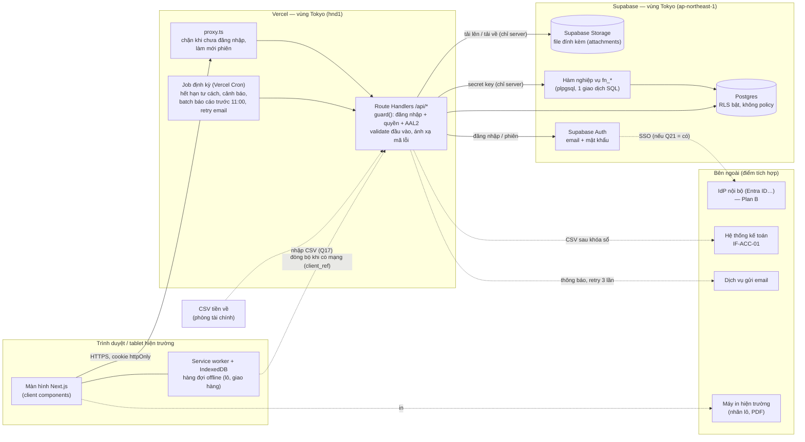
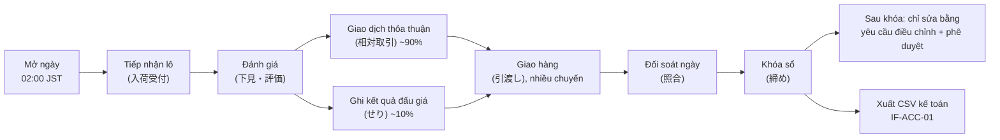
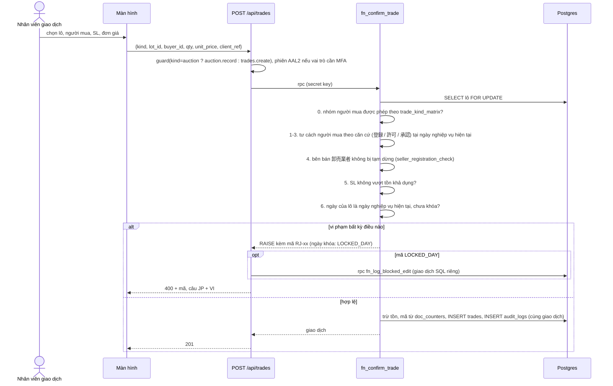
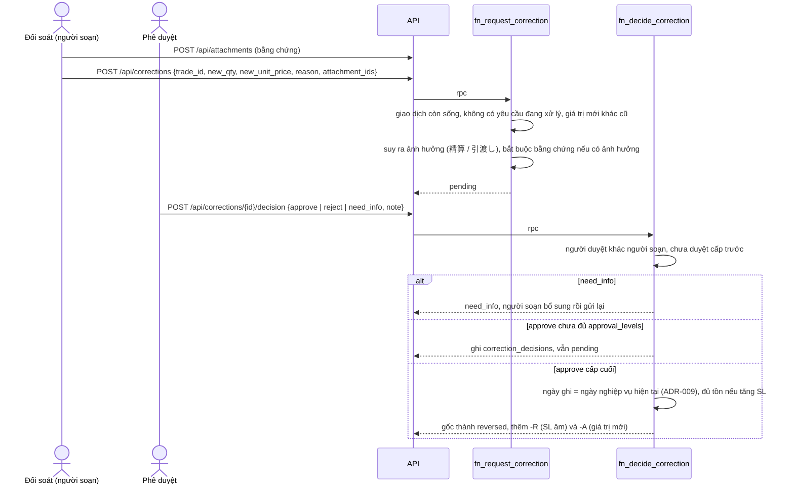

# Kiến trúc hệ thống — Product A (桜水産市場 業務支援システム)

Phạm vi: kiến trúc của prototype LAB-2 (đang chạy tại https://product-a-prototype-gilt.vercel.app) và hướng mở rộng thành hệ thống đầy đủ. Mọi quyết định có ghi vết ở [ADR](adr/). Ràng buộc nghiệp vụ được trích theo mã `BC-xx` ở [01-business-constraints.md](01-business-constraints.md).

## 1. Thành phần

| Thành phần | Trách nhiệm | Không làm |
|---|---|---|
| Service worker + IndexedDB (đích) | Giữ hàng đợi lô / lần giao khi mất mạng, gửi lại theo thứ tự với `client_ref`; màn hình hòa giải liệt kê bản ghi đồng bộ lỗi (ADR-010) | Không chốt giao dịch, không khóa sổ, không duyệt |
| Job định kỳ (đích) | Ghi `expired` cho tư cách quá hạn, gửi cảnh báo hết hạn (BC-07), batch báo cáo ngày trước 11:00 (BC-42), thử lại email 3 lần (BC-63); gọi cùng API / hàm như người dùng | Không quyết thay người ở 4 điểm BC-29 |
| Supabase Storage (đích) | Lưu file của `attachments` (bằng chứng, ảnh giao hàng), lớp lưu trữ theo `retention_class` (BC-82) | Không mở URL công khai; chỉ server cấp link tạm |
| Màn hình (`src/app/(app)`) | Hiển thị, nhập liệu, ẩn / hiện nút theo quyền (chỉ để tiện dùng) | Không quyết định quyền, không gọi thẳng Supabase |
| `proxy.ts` | Chặn mọi trang / API khi chưa có phiên; làm mới phiên Supabase | Không kiểm tra quyền chi tiết |
| Route Handlers (`src/app/api`) | Kiểm tra quyền (`guard`), kiểm tra định dạng đầu vào, gọi hàm nghiệp vụ, ánh xạ mã lỗi của hàm sang câu tiếng Nhật + tiếng Việt (ADR-003), gọi `fn_log_blocked_edit` khi nhận `LOCKED_DAY` (ADR-006) | Không tự cài quy tắc nghiệp vụ cốt lõi |
| Hàm nghiệp vụ `fn_*` | Toàn bộ quy tắc phải đúng tuyệt đối: hiệu lực người tham gia, tồn lượng lô, ngày đã khóa, giao vượt, người duyệt khác người soạn, bút toán đảo | Không biết gì về HTTP hay phiên |
| Postgres | Ràng buộc dữ liệu (CHECK, FK, UNIQUE), cột sinh (`amount`), khóa dòng | — |
| Supabase Auth | Danh tính; hồ sơ và vai trò nằm ở bảng `profiles` | Không chứa vai trò / quyền |

Nguyên tắc: **quy tắc nghiệp vụ nằm một chỗ — trong database** ([ADR-003](adr/ADR-003-business-rules-in-database-functions.md)). Tầng API chỉ là cửa vào có kiểm soát; tầng giao diện không phải là hàng rào bảo mật.

## 2. Luồng dữ liệu chính

### 2.1 Một ngày nghiệp vụ (業務日)

### 2.2 Chốt giao dịch — điểm phân nhánh quan trọng nhất

Vẽ theo **thiết kế đích**; thứ tự kiểm theo đúng 01 §9.1. Chỗ as-built khác (audit ghi ở API sau khi hàm commit, thứ tự kiểm khác) xem G-06, G-24 ở [03-database-diagram.md](03-database-diagram.md) §4.

Phần "tư cách người mua theo căn cứ × loại giao dịch" hiện **chưa có** trong prototype (chỉ xét trạng thái và hạn). Thiết kế đích ở [03-database-diagram.md](03-database-diagram.md) §3, [ADR-007](adr/ADR-007-eligibility-by-basis-kind.md) và [SCR-016](04-screen-specs/scr-016-negotiated-trade-entry.md) §9.

### 2.3 Điều chỉnh sau khóa sổ (確定後修正)

Không bao giờ ghi đè dòng gốc ([ADR-005](adr/ADR-005-append-only-correction-entries.md)).

## 3. Điểm tích hợp

| Mã | Đối tác | Hướng | Prototype | Thiết kế đích | Căn cứ |
|---|---|---|---|---|---|
| INT-01 | Hệ thống kế toán | Ra | Tải CSV từ màn hình Báo cáo (UTF-8 có BOM) | CSV chốt theo ngày đã khóa, phòng tài chính nhập tay (Plan A); SFTP / API nếu Q20 trả lời "tự động" | IF-ACC-01, Q20 |
| INT-02 | Dịch vụ email | Ra | Không có; cảnh báo hiện ở trang chủ | Email thông báo hết hạn, sự cố; thử lại 3 lần; Critical ≤ 5 phút | FR-NOTIFY-01/02 |
| INT-03 | IdP nội bộ | Vào | Không có | SSO OIDC nếu Q21 = có (Plan B) | Q21 |
| INT-04 | Máy in hiện trường | Ra | Không có | In nhãn lô / phiếu (FN-016), PDF báo cáo nếu Q19 | D.3, Q19 |
| INT-06 | Tiền về (thanh toán của người mua) | Vào | Không có | Phòng đối soát nhập tay hoặc nhập CSV; là đầu vào duy nhất để tính 完納奨励金 (liên kết ngân hàng ngoài phạm vi) | Q17, BC-68, SCOPE-OUT-05 |
| INT-05 | Dữ liệu cũ (migration) | Vào | Dữ liệu mẫu `seed.sql` | 3 đợt chuyển đổi, 2 lần diễn tập, đối chiếu số tiền | MIG-01…04 |

## 4. Bảo mật và phân quyền

- **Xác thực:** Supabase Auth, phiên ở cookie httpOnly; `proxy.ts` chặn trước khi vào trang / API. MFA bắt buộc theo phiên đăng nhập (AAL2) cho các vai trò trong `system_settings.mfa_required_roles` — mặc định `sys_admin`, `rule_admin`, `approver`, `settlement` (NFR-SEC-01, BC-85, ADR-008); không hỏi lại theo thao tác. Chưa làm ở prototype.
- **Phân quyền:** vai trò → mã quyền lưu trong `role_permissions`, đọc lại mỗi request ([ADR-004](adr/ADR-004-data-driven-rbac-checked-in-api.md)). Giao diện ẩn nút theo cùng mã quyền nhưng API mới là nơi quyết định.
- **Truy cập dữ liệu:** trình duyệt không có quyền gọi Supabase; RLS bật, không policy; chỉ server với secret key mới đọc / ghi; hàm `fn_*` chỉ cấp `EXECUTE` cho `service_role` ([ADR-002](adr/ADR-002-server-only-database-access.md)).
- **Lưu vết:** mọi thao tác ghi có dòng `audit_logs` (người làm, lúc, trước / sau, lý do) ([ADR-006](adr/ADR-006-audit-log-in-same-transaction.md)).

## 5. Thời gian và ngày nghiệp vụ

Mọi phép so sánh hiệu lực, cảnh báo và mã chứng từ dùng **ngày nghiệp vụ theo giờ Nhật (Asia/Tokyo)**, không dùng `current_date` của máy chủ hay ngày UTC của trình duyệt ([ADR-009](adr/ADR-009-business-day-in-japan-time.md)). Ngày nghiệp vụ hiện tại là ngày **duy nhất** đang `open`; mọi bản ghi mới (lô, giao dịch, lần giao, bút toán điều chỉnh) ghi vào ngày này. Đồng hồ (giờ JST trừ `business_day_start_time`) chỉ dùng cho cảnh báo và gợi ý ngày cần mở. Prototype hiện lệch chỗ này (xem [03-database-diagram.md](03-database-diagram.md) §4).

## 6. Hạ tầng và môi trường

| Hạng mục | Prototype | Ghi chú cho giai đoạn sau |
|---|---|---|
| Ứng dụng | Vercel, function region `hnd1` (Tokyo) | Đề xuất LAB-1 giả định AWS Multi-AZ; giữ hay đổi là quyết định mở, xem [ADR-001](adr/ADR-001-nextjs-fullstack-on-vercel-and-supabase.md) |
| Database | Supabase Free, `ap-northeast-1` | Gói trả phí để tránh tự tạm dừng sau 7 ngày, có backup PITR |
| Môi trường | 1 (production demo) | Tối thiểu dev / staging / production |
| Mã nguồn | GitHub `linhntd-3068/Learning-AI-Product-A`, Vercel tự deploy khi push `main` | Thêm CI chạy typecheck, lint, test SQL trước khi deploy |
