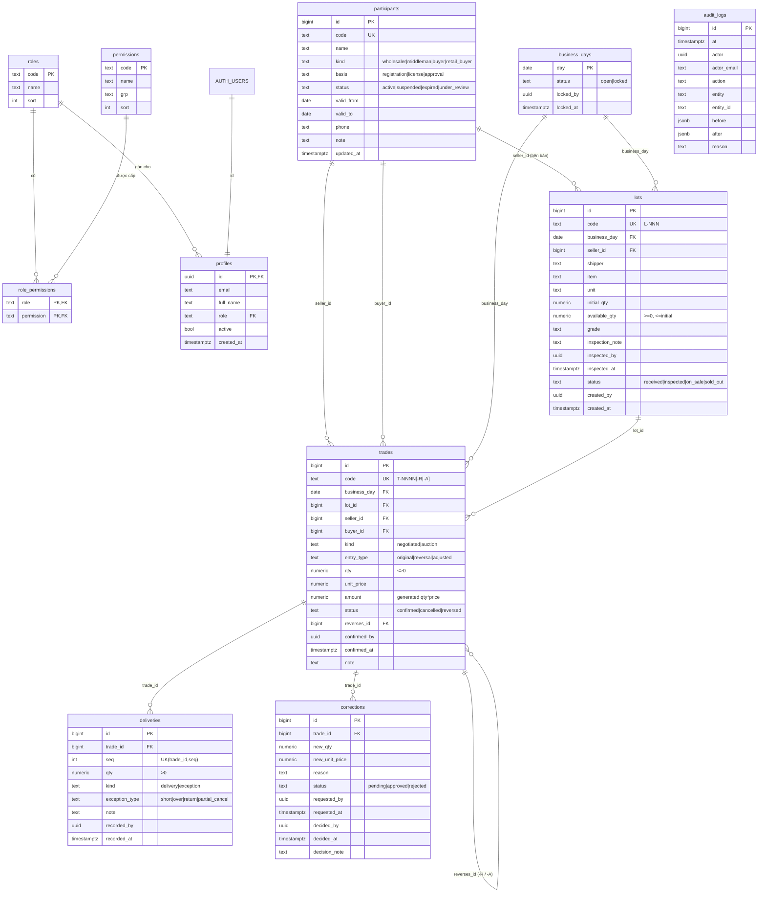

# Sơ đồ cơ sở dữ liệu — thực tế LAB-2 và thiết kế đích

Nguồn thực tế: `supabase/migrations/0001_schema.sql`, `0002_business_functions.sql`, `supabase/seed.sql` (đã đối chiếu từng cột). Thiết kế đích theo [ADR-005…010](adr/) và ràng buộc `BC-xx` ở [01-business-constraints.md](01-business-constraints.md).

## 1. ERD thực tế (as-built, đúng bảng đã tạo ở LAB-2)

Ghi chú thực tế:
- 11 bảng, đều bật RLS, không policy (ADR-002).
- Chỉ `profiles.id → auth.users.id` là FK tới người dùng. Mọi cột "người làm" (`*_by`, `actor`) là uuid trơn, không FK.
- `trades.amount` là cột sinh `round(qty × unit_price)`, JPY, chưa thuế.
- Trạng thái giao hàng (chờ / một phần / xong / ngoại lệ) không lưu, tính trong `src/lib/api/delivery-status.ts`.
- Tài khoản demo do `scripts/create-demo-users.mjs` tạo; `seed.sql` không tạo người dùng.
- CHECK phụ không vẽ trong ERD: `participants valid_to >= valid_from`, `lots.initial_qty > 0`, `trades.unit_price >= 0`, `corrections.new_qty > 0`, `deliveries (kind = 'exception') = (exception_type is not null)`; mặc định `lots.unit = 'kg'`.

## 2. ERD thiết kế đích

Chỉ vẽ các bảng thêm hoặc đổi; với bảng có sẵn ở §1 chỉ vẽ **cột thêm / đổi** (cột cũ giữ nguyên). Mọi cột người làm (`*_by`, `actor`, `maker_id`, `checker_id`) FK tới `profiles(id)`; để sơ đồ đọc được, chỉ vẽ vài quan hệ tới `profiles`.

```mermaid
erDiagram
  party_kinds ||--o{ party_kind_basis : "được phép căn cứ"
  party_kinds ||--o{ participants : "kind"
  participants ||--o{ participant_qualifications : "có lịch sử tư cách"
  party_kind_basis ||--o{ participant_qualifications : "(kind, basis_type)"
  participant_qualifications ||--o{ qualification_events : "vòng đời"
  rule_sets ||--o{ rule_values : "khóa quy tắc"
  rule_sets ||--o{ item_tax_rates : "thuế suất theo phiên bản"
  items ||--o{ item_tax_rates : "item_code"
  items ||--o{ lots : "item_code"
  rule_sets ||--o{ trades : "rule_set_id áp dụng"
  market_calendar ||--o| business_days : "ngày không nghỉ"
  business_days ||--o{ deliveries : "business_date của lần giao"
  business_days ||--o{ day_reopen_requests : "yêu cầu mở lại"
  day_reopen_requests ||--o{ day_reopen_decisions : "quyết định theo cấp"
  business_days ||--o{ doc_counters : "bộ đếm mã theo ngày"
  corrections ||--o{ correction_decisions : "quyết định theo cấp"
  corrections ||--o{ attachments : "bằng chứng"
  deliveries ||--o{ attachments : "ảnh / chứng từ"
  participant_qualifications ||--o{ attachments : "bằng chứng tư cách"
  business_days ||--o{ accounting_exports : "chỉ ngày đã khóa"
  accounting_exports ||--o{ accounting_export_lines : "dòng theo người tham gia"
  participants ||--o{ accounting_export_lines : "participant_id"
  profiles ||--o{ trades : "confirmed_by, recorded_by"
  profiles ||--o{ system_settings : "updated_by"

  party_kinds {
    text kind PK "wholesaler|middleman|participant_buyer|point_buyer"
    text name_ja "卸売業者|仲卸|売買参加者|買出人"
  }
  party_kind_basis {
    text kind PK,FK
    text basis_type PK "market_registration|permit|approval|point_registration"
    text suspend_policy "approval|conditional|re_review|direct"
  }
  participants {
    bigint id PK
    text code UK
    text name
    text kind FK
    text phone
    text note
    timestamptz updated_at
  }
  participant_qualifications {
    bigint id PK
    bigint participant_id FK
    text basis_type FK
    text number "số 許可/承認, bắt buộc với permit, approval (S)"
    text issuer
    date valid_from
    date valid_to "null chỉ với market_registration (S)"
    text status "valid|suspended|expired|re_review"
    text conditions "chỉ permit"
    uuid approved_by FK
    bigint evidence_id FK
    timestamptz updated_at "khóa lạc quan (version)"
  }
  qualification_events {
    bigint id PK
    bigint qualification_id FK
    text event "apply|approve|suspend|lift|expire|re_review"
    uuid actor FK
    text reason
    jsonb payload "conditions_met_note, new_valid_to, kết quả 再審査"
    timestamptz at
  }
  rule_sets {
    bigint id PK
    int version_no UK
    date effective_from
    text status "draft|submitted|approved|superseded"
    uuid maker_id FK
    uuid checker_id FK "<> maker"
    text change_reason
    text over_limit_reason "bắt buộc từ lần thứ 5 trong năm"
    bigint rollback_of FK
    timestamptz approved_at
  }
  rule_values {
    bigint rule_set_id PK,FK
    text key PK "chỉ khóa trong danh mục ADR-008"
    jsonb value
  }
  system_settings {
    text key PK "danh mục ADR-008, hiệu lực ngay"
    jsonb value
    uuid updated_by FK
    timestamptz updated_at
  }
  items {
    text code PK
    text name
    text unit "cố định theo mặt hàng (BC-37)"
  }
  item_tax_rates {
    text item_code PK,FK
    bigint rule_set_id PK,FK
    numeric tax_rate "0..1"
  }
  market_calendar {
    date day PK
    bool is_holiday
    text note
  }
  business_days {
    date day PK
    text status "open|closing|reopened|locked, tối đa một open"
    uuid opened_by FK
    timestamptz opened_at
    text open_reason "bắt buộc khi ngày trước chưa khóa"
    uuid locked_by FK
    timestamptz locked_at
    text lock_comment
    jsonb lock_checklist_snapshot
    bool exported
  }
  day_reopen_requests {
    bigint id PK
    date day FK
    uuid requested_by FK
    timestamptz requested_at
    text reason
    text status "pending|approved|rejected"
    int current_level
  }
  day_reopen_decisions {
    bigint id PK
    bigint request_id FK
    int level
    text decision "approve|reject"
    uuid decided_by FK
    text note
    timestamptz at
  }
  doc_counters {
    date day PK,FK
    text kind PK "lot|trade"
    int last_no
  }
  lots {
    bigint id PK
    text item_code FK "thay lots.item, lots.unit"
    text client_ref UK "chống trùng khi đồng bộ offline"
  }
  trades {
    bigint id PK
    bigint rule_set_id FK
    uuid confirmed_by FK "せり: 確認者 chọn tường minh"
    uuid recorded_by FK "người nhập"
    timestamptz result_at "thời điểm chốt せり"
    uuid cancelled_by FK
    timestamptz cancelled_at
    text cancel_reason
    text client_ref UK
  }
  deliveries {
    bigint id PK
    date business_date FK "ngày hiện tại lúc ghi"
    text client_ref UK
    uuid recorded_by FK
    uuid confirmed_by FK "xác nhận ngoại lệ"
    timestamptz confirmed_at "null = ngoại lệ còn mở"
    text confirm_comment
    text qualification_flag "null|expired_after_confirm"
    bool disputed "chỉ với kind = exception"
    text dispute_note
    uuid dispute_resolved_by FK "khác recorded_by"
    timestamptz dispute_resolved_at
    text dispute_resolution_note
  }
  corrections {
    bigint id PK
    bool impact_settlement
    bool impact_delivery
    text status "pending|need_info|approved|rejected"
    int current_level
  }
  correction_decisions {
    bigint id PK
    bigint correction_id FK
    int level
    text decision "approve|reject|need_info"
    uuid decided_by FK
    text note
    timestamptz at
  }
  attachments {
    bigint id PK
    text owner_type "qualification|correction|delivery"
    bigint owner_id
    text storage_path
    text mime_type
    int size_bytes
    text retention_class "BUSINESS_7Y|EVIDENCE_3Y_COLD"
    uuid uploaded_by FK
    timestamptz uploaded_at
  }
  accounting_exports {
    bigint id PK
    text batch_code UK
    date business_day FK
    uuid run_by FK
    timestamptz run_at
    text encoding
  }
  accounting_export_lines {
    bigint id PK
    bigint export_id FK
    bigint participant_id FK
    numeric amount
    numeric tax
    text line_status "保留|確認済み|調整済み"
  }
  profiles {
    uuid id PK
  }
```

Thay đổi so với thực tế:
- **Tư cách tham gia** tách khỏi `participants` sang `participant_qualifications`; nhóm ↔ căn cứ ràng buộc bằng `party_kind_basis` (ADR-007, BC-01…05). Cột `participants.basis / status / valid_from / valid_to` được migrate rồi bỏ. Khoảng hiệu lực cùng căn cứ không chồng nhau (exclusion constraint, giả định S). Sự kiện lưu chi tiết ở `qualification_events.payload`.
- **Quy tắc có phiên bản** `rule_sets` (`draft → submitted → approved → superseded`) + `rule_values`; giao dịch lưu `rule_set_id` đã áp dụng (ADR-008, BC-14…20).
- **Tham số bảo mật / vận hành** ở `system_settings`, hiệu lực ngay, không tính vào giới hạn 4 lần / năm (ADR-008).
- **Danh mục mặt hàng** `items(code PK)` (đơn vị) không phiên bản; thuế suất theo phiên bản ở `item_tax_rates` (BC-22, BC-37, BC-70). `lots.item_code` FK `items.code`.
- **Ngày nghiệp vụ** có trạng thái `open | closing | reopened | locked`, tối đa một ngày `open` (partial unique index); lý do mở, ghi chú khóa, snapshot checklist lưu ở `business_days` (ADR-009, SCR-024). Mở lại có duyệt nhiều cấp: `day_reopen_requests` + `day_reopen_decisions` (BC-48).
- **Mã chứng từ** từ `doc_counters(day, kind)`, chỉ đếm dòng gốc (G-18).
- **Giao hàng** có `business_date` riêng, `client_ref` chống trùng, người / lúc xác nhận ngoại lệ, cờ tư cách, và **cờ tranh chấp** `disputed` + người giải quyết (BC-50, BC-56, BC-57, SCR-029). Màn hình tranh chấp đầy đủ (SCR-026/027) để giai đoạn sau.
- **Điều chỉnh** có cờ ảnh hưởng, trạng thái `need_info`, quyết định theo cấp `correction_decisions` (BC-45, BC-46).
- **Bằng chứng** `attachments` có lớp lưu trữ (BC-45, BC-82).
- **Xuất kế toán** có batch code (header `accounting_exports`) và trạng thái **theo dòng** ở `accounting_export_lines` (BC-71, BC-72).
- **Mọi cột người làm** có FK tới `profiles(id)`; `trades` có `cancelled_by / cancelled_at / cancel_reason`, `recorded_by`, `result_at` (G-11, G-22).
- **`audit_logs`** chỉ cho thêm (trigger chặn UPDATE / DELETE), ghi trong cùng giao dịch (ADR-006). Thêm index `(action, entity_id, at)` để đếm lần đăng nhập sai theo email trong cửa sổ thời gian (SCR-001); với `login_failed`, `entity_id` = email đã chuẩn hóa.
- **Seed:** vai trò `rule_admin`; mã quyền mới theo ADR-004.

## 3. Mô hình tư cách tham gia (chỗ đề bài đòi phân nhánh)

| Nhóm (`party_kinds`) | Căn cứ hợp lệ (`party_kind_basis`) | Tạm dừng → gỡ | Kiểm khi |
|---|---|---|---|
| 卸売業者 `wholesaler` | `market_registration` | Gỡ cần người duyệt (承認) | Bán (tạo lô, chốt) — chỉ kiểm tạm dừng (Q33) |
| 仲卸 `middleman` | `permit` (許可) | Gỡ khi đủ `conditions` (条件付き) | Mua: chốt + giao |
| 売買参加者 `participant_buyer` | `approval` (承認) | Bắt buộc qua `re_review` (再審査) | Mua: chốt + giao |
| 買出人 `point_buyer` | `point_registration` | Gỡ trực tiếp (`direct`, giả định S) | Mua: chốt + giao (hạn theo EX-02, mâu thuẫn M1) |

Ánh xạ từ dữ liệu prototype: `buyer` → `participant_buyer`; `retail_buyer` → `point_buyer`; `license` → `permit`; `registration` của wholesaler → `market_registration`, của retail_buyer → `point_registration`; `approval` → `approval`.

## 4. Chỗ prototype làm khác thiết kế (gap)

Mỗi dòng sẽ thành một hoặc nhiều task ở LAB-5. Mức: **Cao** = vi phạm ràng buộc bắt buộc / tiêu chí loại; **TB** = sai nghiệp vụ nhưng có cách vòng; **Thấp** = nợ kỹ thuật.

| Mã | Prototype đang làm | Thiết kế đúng | Mức | Căn cứ |
|---|---|---|---|---|
| G-01 | `basis` chỉ lưu; ba căn cứ xử lý như nhau | Tách `participant_qualifications`, kiểm theo căn cứ, thông báo riêng | **Cao** (12-06 loại hồ sơ) | ADR-007, BC-01 |
| G-02 | Giao hàng kiểm tư cách theo `current_date` (UTC); UI dùng ngày UTC | Kiểm theo `business_date` của lần giao, JST | **Cao** | ADR-009, BC-39 |
| G-03 | `fn_record_delivery` không chặn ngày đã khóa | Chặn và ghi log lần bị chặn | **Cao** | BC-43 |
| G-04 | Đánh giá lô ghi thẳng bảng, đánh giá được lô của ngày đã khóa | Qua `fn_inspect_lot`, chặn ngày khóa, lý do bắt buộc khi lô đã có giao dịch | **Cao** | BC-43, BC-47 |
| G-05 | Không có phiên bản quy tắc; ngưỡng 30 ngày, đơn vị, hạng A/B/C hardcode | `rule_sets` + `rule_values`; đọc qua `fn_rule` | **Cao** | ADR-008, BC-19 |
| G-06 | Audit ghi sau thao tác ở API; lỗi audit vẫn giữ thao tác; không log lần bị chặn | Ghi trong cùng giao dịch, bảng chỉ thêm | **Cao** (KPI-03) | ADR-006, BC-81 |
| G-07 | Không mở được ngày mới (chỉ seed); không có lịch chợ | `fn_open_day` + `market_calendar` | TB | ADR-009, BC-41 |
| G-08 | Khóa sổ không có checklist | Checklist CK-1…7 (SCR-024): giao dịch chờ, đồng bộ offline, ngoại lệ chưa xác nhận, giao hàng mở, ngoại lệ `disputed` chưa giải quyết… | TB | BC-49 |
| G-09 | Không mở lại được ngày đã khóa | Mở lại có duyệt (`day_reopen_requests`, trạng thái `reopened`); đã xuất kế toán thì bắt buộc dùng bút toán | TB | BC-48, Q12 |
| G-10 | Yêu cầu điều chỉnh không có bằng chứng, không có "yêu cầu thêm thông tin" | `attachments` bắt buộc khi ảnh hưởng quyết toán / giao hàng; thêm trạng thái `need_info` | TB | BC-45 |
| G-11 | Hủy giao dịch: không lưu người hủy, lý do nối vào `note` | `cancelled_by / cancelled_at / cancel_reason` | TB | BC-47, BC-81 |
| G-12 | Ngoại lệ `return / partial_cancel` không đổi SL giao dịch / tồn lô; một ngoại lệ là trạng thái "ngoại lệ" mãi | Quy tắc tồn theo loại ngoại lệ; ngoại lệ có người xác nhận, đóng được | TB | BC-56, BC-57 |
| G-13 | Duyệt điều chỉnh không cập nhật `lots.status` | Trạng thái lô suy ra từ tồn, không lưu cứng | Thấp | BC-38 |
| G-14 | Cột người làm không có FK | FK tới `profiles(id)` | Thấp | BC-81 |
| G-15 | Mặt hàng, đơn vị, chủ hàng là text tự do | Bảng `items` (đơn vị, thuế suất) | TB | BC-37, BC-70 |
| G-16 | Không có vai trò `rule_admin`; có `market_ops` (RFP không có) | Thêm `rule_admin`; `market_ops` giữ, ghi là giả định; seed 9 mã quyền mới (ADR-004) | TB | BC-87, ADR-004 |
| G-17 | Một số quy tắc chỉ ở API (một yêu cầu pending / giao dịch, grade A/B/C, lý do khi từ chối) | Chuyển vào DB: unique index một phần, CHECK, tham số hàm | Thấp | ADR-003 |
| G-18 | Mã chứng từ = count(*)+1; dòng -R/-A cũng tăng bộ đếm ngày ghi | Bảng `doc_counters(day, kind)` | Thấp | BC-31 |
| G-19 | Không có MFA | MFA theo phiên (AAL2) cho `system_settings.mfa_required_roles`: `sys_admin`, `rule_admin`, `approver` (B) + `settlement` (mặc định, S) | **Cao** | BC-85, NFR-SEC-01 |
| G-20 | Không có offline | Hàng đợi cho tiếp nhận lô và giao hàng, `client_ref` | TB | ADR-010 |
| G-21 | Xuất CSV (`/api/reports/trades`) chạy được cho ngày **chưa khóa**; không có batch code, trạng thái dòng, người chạy | Chỉ xuất ngày đã khóa; bảng `accounting_exports` (batch code, metadata) + `accounting_export_lines` (trạng thái dòng 保留 / 確認済み / 調整済み) | **Cao** (T20) | BC-71, BC-72 |
| G-22 | Kết quả せり: `confirmed_by` luôn là người gọi API; không có trường 確認者 (người điều hành せり) và thời điểm chốt | Thêm `trades.result_at`, `trades.recorded_by`; `confirmed_by` chọn người điều hành, bắt buộc | **Cao** (BC-28, BC-29) | SCR-019 |
| G-23 | Không khóa tạm khi nhập sai nhiều lần, không timeout phiên theo cấu hình | Đếm lần sai, khóa tạm, timeout nhàn rỗi / tuyệt đối từ `system_settings` (hiệu lực ngay, ADR-008) | TB | BC-86, SCR-001 |
| G-24 | Thứ tự kiểm khi chốt khác bảng 9.1; câu lỗi chỉ tiếng Việt; nhãn căn cứ dùng chung cho 卸売業者 và 買出人 | Thứ tự 9.1, mã lý do RJ-xx, câu JP + VI; nhãn theo căn cứ | TB | BC-01, BC-89, SCR-010/016 |

Điều tốt cần giữ: tồn lô không âm và khóa dòng khi chốt; chặn người soạn tự duyệt; bút toán đảo -R / -A không ghi đè; RLS chặn toàn bộ truy cập từ client; hàm chỉ `service_role` gọi được.
