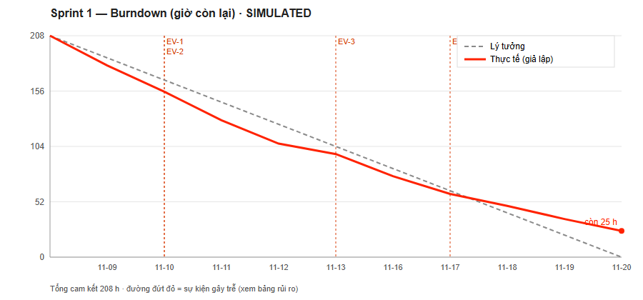

# Báo cáo tiến độ Sprint 1 — Product A (桜水産市場 業務支援システム)

**Kỳ báo cáo:** Sprint 1 (2026-11-09 → 2026-11-20) · **Ngày báo cáo:** 2026-11-20 · **Người lập:** Nguyễn Thị Diệu Linh (BrSE/PM)

> **SỐ LIỆU GIẢ LẬP (LAB-5).** Dự án chưa kick-off; trạng thái task, giờ thực tế và burndown được sinh bằng `scripts/github-project/simulate_sprint_progress.py` từ backlog thật trên GitHub Project, có 4 sự kiện gây trễ đặt có chủ đích. Khung báo cáo, cách tính và rủi ro dùng được ngay khi có số thật.

Board: https://github.com/users/linhntd-3068/projects/1 · Repo: https://github.com/linhntd-3068/Learning-AI-Product-A

## 1. Tóm tắt

- **Trạng thái: VÀNG.** Hoàn thành **86/120 SP (72%)**, 27/34 task; còn **25 giờ** việc chuyển sang Sprint 2 (đường lý tưởng = 0).
- **Chậm ở phần backend:** 2 task DB vượt ước lượng tổng **+8.8 giờ** (ngày nghiệp vụ JST, migrate tư cách 許可/承認). BE đã kín 107/112 giờ ngay từ kế hoạch nên không có dư địa hấp thụ.
- **Rủi ro lớn nhất: epic 完納奨励金 (18 task, 130 giờ, rải từ Sprint 1 tới Sprint 5) chưa thể chốt spec** vì khách chưa trả lời Q16 (bảng tỷ lệ, 支払期日) và Q17 (cách biết đã trả tiền).
- **Sprint 2 đang quá tải BE khoảng 13 giờ** nếu giữ nguyên kế hoạch: 104 giờ đã lên kế hoạch + 9.6 giờ chuyển sang, trong khi năng lực BE chỉ còn 101 giờ do nghỉ lễ 23/11.
- **Cần khách:** trả lời Q16/Q17 trước **27/11**; xác nhận hạn tham gia của 買出人 (mâu thuẫn RFP); bố trí người review UI thay thế.

## 2. Kết quả theo epic

| Epic | Ràng buộc đặc thù | Task trong sprint | SP cam kết | SP xong | Ghi chú |
|---|---|---|---|---|---|
| E-AUD Audit nghiệp vụ trong cùng giao dịch (ADR-006) | — | 2 | 10 | 10 | xong |
| E-RULE Quy tắc chợ có phiên bản & tham số hệ thống (ADR-008, SCR-034) | Quy tắc phiên bản | 6 | 19 | 16 | còn T-RULE-03 |
| E-BDAY Ngày nghiệp vụ JST & mở ngày (ADR-009) | Ngày nghiệp vụ JST | 6 | 18 | 13 | còn T-BDAY-05 |
| E-QUAL Tư cách tham gia theo căn cứ 登録/許可/承認 (ADR-007, SCR-010) | 許可/承認 | 3 | 10 | 5 | còn T-QUAL-03 |
| E-LOCK Đối soát, khóa sổ, mở lại & điều chỉnh -R/-A (SCR-022/024) | Ngày khóa & điều chỉnh | 4 | 17 | 4 | còn T-LOCK-03, T-LOCK-05 |
| E-FND Nền tảng dữ liệu, phân quyền & spec chung | — | 5 | 23 | 23 | xong |
| E-INC 完納奨励金 — khuyến khích thanh toán đủ đúng hạn | 完納奨励金 | 2 | 8 | 0 | còn T-INC-01, T-INC-18 |
| E-AUC Ghi kết quả せり có người xác nhận (SCR-019) | せり xác nhận | 1 | 1 | 1 | xong |
| E-SEC Đăng nhập, MFA, khóa tạm & timeout (SCR-001) | MFA/Bảo mật | 1 | 1 | 1 | xong |
| E-OFF Offline cho tiếp nhận lô & giao hàng (ADR-010) | Offline | 2 | 10 | 10 | xong |
| E-TRADE Chốt giao dịch 相対 & hủy (SCR-016/018) | — | 1 | 2 | 2 | xong |
| E-DEL Ghi giao hàng, ngoại lệ & tranh chấp (SCR-029) | — | 1 | 1 | 1 | xong |

## 3. Trạng thái task

| Done | In Review | In Progress | Blocked | Todo |
|---|---|---|---|---|
| 27 | 1 | 2 | 1 | 3 |

Task chưa xong (chuyển Sprint 2):

| Task | Issue | Trạng thái | Phụ trách | Ước lượng / thực tế / còn (giờ) | Lý do |
|---|---|---|---|---|---|
| T-LOCK-03 Sửa `fn_decide_correction`: nhiều cấp, need_info, sinh -R/-A ở ngày hiện tại | [#105](https://github.com/linhntd-3068/Learning-AI-Product-A/issues/105) | In Progress | BE Bình | 12 / 9.2 / 2.8 | BE Bình hết giờ trong sprint do T-BDAY-02 vượt +4.8 giờ |
| T-QUAL-03 Migrate tư cách từ `participants` sang bảng mới rồi bỏ cột cũ | [#56](https://github.com/linhntd-3068/Learning-AI-Product-A/issues/56) | In Progress | BE An | 8 / 11.2 / 0.8 | EV-3: Migrate basis cũ sang participant_qualifications: 買出人 thiếu hạn tham gia (mâu thuẫn M1 trong RFP), phải hỏi lại |
| T-INC-01 Soạn spec nghiệp vụ 完納奨励金 và gửi câu hỏi Q16/Q17/Q29/Q30 | [#130](https://github.com/linhntd-3068/Learning-AI-Product-A/issues/130) | Blocked | BrSE Linh | 8 / 7.0 / 1.0 | EV-1: Spec 完納奨励金 không chốt được: khách chưa trả lời Q16 (bảng tỷ lệ, 支払期日) và Q17 (cách biết đã trả tiền) |
| T-RULE-03 Viết `fn_rule_set(date)`, `fn_rule(key, date)` và seed phiên bản v1 | [#33](https://github.com/linhntd-3068/Learning-AI-Product-A/issues/33) | Todo | BE Bình | 6 / 0.0 / 6.0 | BE Bình hết giờ trong sprint do T-BDAY-02 vượt +4.8 giờ |
| T-BDAY-05 Thay ngày UTC ở UI bằng 業務日 từ server | [#50](https://github.com/linhntd-3068/Learning-AI-Product-A/issues/50) | In Review | FE Dũng | 8 / 8.0 / 0.0 | EV-4: Review UI đổi ngày nghiệp vụ chậm: reviewer phía khách nghỉ phép, task nằm ở In Review qua cuối sprint |
| T-LOCK-05 Dựng màn hình duyệt điều chỉnh SCR-022 | [#107](https://github.com/linhntd-3068/Learning-AI-Product-A/issues/107) | Todo | FE Chi | 8 / 0.0 / 8.0 | Chờ task phụ thuộc: T-LOCK-03 |
| T-INC-18 Viết kịch bản UAT 完納奨励金 | [#147](https://github.com/linhntd-3068/Learning-AI-Product-A/issues/147) | Todo | BrSE Linh | 6 / 0.0 / 6.0 | Chờ task phụ thuộc: T-INC-01 |

Tổng việc còn lại chuyển sang: **24.6 giờ**.

## 4. Burndown

| Ngày | 11-09 | 11-10 | 11-11 | 11-12 | 11-13 | 11-16 | 11-17 | 11-18 | 11-19 | 11-20 |
|---|---|---|---|---|---|---|---|---|---|---|
| Lý tưởng (giờ) | 187 | 166 | 146 | 125 | 104 | 83 | 62 | 42 | 21 | 0 |
| Thực tế (giờ) | 180 | 155 | 129 | 107 | 97 | 76 | 59 | 48 | 36 | 25 |

Đọc biểu đồ: nửa đầu sprint chạy nhanh hơn lý tưởng vì các task BrSE / FE nhỏ xong sớm; từ 17/11 đường thực tế nằm trên lý tưởng do hai task DB vượt giờ (EV-2, EV-3) và task spec 完納奨励金 bị chặn (EV-1). Số giờ còn lại cuối sprint tập trung ở BE và đường phụ thuộc corrections → màn hình duyệt (T-LOCK-03 → T-LOCK-05).

## 5. Rủi ro trễ tiến độ

| # | Rủi ro | Ảnh hưởng cụ thể | Khả năng | Mức | Hành động | Người / hạn |
|---|---|---|---|---|---|---|
| R1 | Khách chưa trả lời Q16 (bảng tỷ lệ, định nghĩa 支払期日) và Q17 (nguồn dữ liệu đã trả tiền) | Epic 完納奨励金 130 giờ không chốt được spec; T-INC-03, T-INC-05, T-INC-11 phải ước lượng lại; trễ tới ngày nào phụ thuộc ngày khách trả lời | Cao | **Cao** | Gửi lại câu hỏi kèm 2 phương án mặc định để khách chọn; nếu tới 27/11 chưa có thì dựng theo Plan A và ghi rõ rủi ro làm lại | BrSE Linh · 27/11 |
| R2 | Backend là nút cổ chai | Sprint 2: kế hoạch BE 104 giờ + chuyển sang 9.6 giờ, năng lực còn 101 giờ (nghỉ 23/11) → thiếu ~13 giờ; trượt chuỗi corrections và các màn hình phụ thuộc | Cao | **Cao** | Chuyển 2–3 task DB đơn giản (QUAL / RULE) cho FE biết SQL; dời task P2 của Sprint 2 sang Sprint 3 | PM · 23/11 (planning Sprint 2) |
| R3 | RFP mâu thuẫn về hạn tham gia của 買出人 (M1) | T-QUAL-03 migrate tư cách vượt giờ và còn dở; nếu chọn sai phải migrate lại | TB | TB | Thêm câu hỏi mới cho khách; tạm để `valid_to` bắt buộc với 買出人 theo spec SCR-010, ghi giả định | BrSE Linh · 24/11 |
| R4 | Người review UI phía khách vắng | T-BDAY-05 nằm ở In Review qua cuối sprint; các màn hình Sprint 2–3 cũng cần review | TB | TB | Đề nghị khách cử người review thay thế; review nội bộ trước để rút thời gian review của khách | PM · 25/11 |
| R5 | Lịch nghỉ Nhật chưa tính vào kế hoạch (23/11; nghỉ cuối năm rơi vào Sprint 4) | Năng lực thực tế thấp hơn kế hoạch ~10% ở Sprint 2 và Sprint 4 | Chắc chắn | TB | Trừ ngày nghỉ khỏi năng lực khi lập kế hoạch Sprint 2 và Sprint 4 | PM · planning từng sprint |
| R6 | FE và QA dùng chưa hết năng lực (Sprint 1: FE 52/112 giờ, QA 18/56 giờ) trong khi BE quá tải | Tổng thời gian dự án dài thêm khoảng 1 sprint nếu không cân lại | Cao | TB | Cân lại vai trò ở Sprint 2 (xem R2); QA viết test tích hợp sớm cho các hàm SQL | PM · 23/11 |
| R7 | Kiểm thử dồn về cuối dự án (QA theo kế hoạch: Sprint 1 18 h, Sprint 2 6 h, Sprint 3 0 h, Sprint 4 22 h, Sprint 5 56 h, Sprint 6 43 h; năng lực 56 h/sprint) | Lỗi tích hợp phát hiện muộn ở Sprint 5–6, không còn sprint đệm trước UAT | Cao | **Cao** | QA viết test tích hợp cho hàm SQL ngay khi BE xong từng epic (Sprint 2–3 đang gần như trống QA); đã dời test biên 完納奨励金 (T-INC-17) từ Sprint 6 về Sprint 4 | PM + QA Hà · planning Sprint 2 |

## 6. Kế hoạch Sprint 2 và đề nghị với khách

- Sprint 2 (2026-11-23 → 2026-12-04): kế hoạch 20 task / 78 SP / 142 giờ, cộng 7 task chuyển sang (24.6 giờ). Đề xuất dời task P2 để giữ cam kết ≤ năng lực sau khi trừ ngày nghỉ.
- Ưu tiên đầu Sprint 2: hoàn tất T-LOCK-03 (sinh bút toán -R/-A) để mở khóa T-LOCK-05 (màn hình duyệt), T-RULE-03 (`fn_rule`) để các epic dùng quy tắc có phiên bản.
- Đề nghị khách: (1) trả lời Q16, Q17, Q29, Q30 trước 27/11; (2) xác nhận hạn tham gia của 買出人; (3) cử người review UI thay thế.

## 7. Định nghĩa và cách tính

- Story point suy ra từ giờ ước lượng: {"rule": "SP derived from honest hour estimate (AI-assisted, tests included); max 8 SP / 16 h, larger must be split", "bands": [{"story_points": 1, "hours": "1-2"}, {"story_points": 2, "hours": "3-4"}, {"story_points": 3, "hours": "5-7"}, {"story_points": 5, "hours": "8-11"}, {"story_points": 8, "hours": "12-16"}], "approx": "1 SP ≈ 2 h"}.
- Năng lực: 8 giờ/ngày × 10 ngày × hệ số tập trung 0.7 = 56 giờ/người/sprint; đội BrSE×1, BE×2, FE×2, QA×1 (người phụ trách là giả định).
- "Done" = đã review và đạt định nghĩa xong của task; "In Review" chưa tính vào SP hoàn thành. Burndown tính theo giờ còn lại của task chưa Done.

## 8. Số giờ thật đã dùng cho bài LAB-5

| Tuần | Việc chính | Giờ thực tế |
|---|---|---|
| Tuần 1 | Break task từ thiết kế LAB-4, dựng GitHub Project | __ h |
| Tuần 2 | Giả lập sprint, burndown, báo cáo tiến độ, rà soát | __ h |
| Tổng | | __ h |
