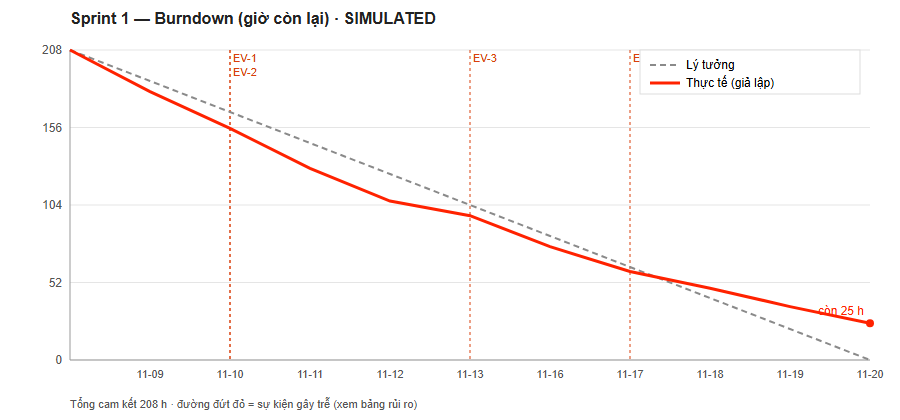

# Báo cáo tiến độ — Sprint 1 · Product A (桜水産市場 業務支援システム)

**Iteration trên Project:** `Sprint 1` (trường `Iteration` trên Project, 6 sprint 2 tuần từ 2026-11-09) · **Khoảng thời gian giả lập:** 2026-11-09 → 2026-11-20 (10 ngày làm việc) · **Ngày báo cáo:** 2026-11-20 · **Người lập:** Nguyễn Thị Diệu Linh (BrSE/PM)

> **Số liệu giả lập.** Dự án chưa kick-off. Trạng thái, giờ thực tế và burndown do `scripts/github-project/simulate_sprint_progress.py` sinh từ backlog thật trên Project, có 4 sự kiện gây trễ đặt có chủ đích (EV-1…EV-4). Bản đầy đủ gửi khách (có kết quả theo epic, kế hoạch Sprint 2): [`docs/lab5/sprint1-progress-report.md`](docs/lab5/sprint1-progress-report.md) và bản Word.

**Tóm tắt — VÀNG:**
- Xong **92/125 SWP (74%)**, 27/34 issue; ~25 giờ việc chuyển sang Sprint 2.
- Backend là nút cổ chai.
- Spec 完納奨励金 bị chặn chờ khách trả lời Q16/Q17.

## 1. Trạng thái

| Trạng thái | Số issue | Tổng SWP | Ghi chú |
|---|---:|---:|---|
| Done | 27 | 92 | Đã review; thực tế 156,8 giờ so với ước 152 giờ |
| In Review | 1 | 4 | #50 (T-BDAY-05): code xong, reviewer UI phía khách nghỉ phép (EV-4). Chưa tính vào SWP xong |
| In Progress | 2 | 16 | #105 (T-LOCK-03) còn 2,8 giờ; #56 (T-QUAL-03) còn 0,8 giờ, vượt ×1,5 do mâu thuẫn M1 (EV-3) |
| Blocked | 1 | 3 | #130 (T-INC-01) spec 完納奨励金 chờ Q16/Q17 (EV-1) |
| Todo | 3 | 10 | #33 (T-RULE-03), #107 (T-LOCK-05) chờ #105, #147 (T-INC-18) chờ #130 |
| **Tổng Sprint 1** | **34** | **125** | Cam kết 208 giờ |
| Backlog (Sprint 2–6) | 99 | 383 | Chưa bắt đầu |

## 2. Burndown

Giờ còn lại tính ở **cuối mỗi ngày**. Đầu sprint là 208 giờ, nên giá trị lý tưởng ngày đầu là 187.

| Ngày | 11-09 | 11-10 | 11-11 | 11-12 | 11-13 | 11-16 | 11-17 | 11-18 | 11-19 | 11-20 |
|---|---:|---:|---:|---:|---:|---:|---:|---:|---:|---:|
| Lý tưởng (giờ) | 187 | 166 | 146 | 125 | 104 | 83 | 62 | 42 | 21 | 0 |
| Thực tế (giờ) | 180 | 155 | 129 | 107 | 97 | 76 | 59 | 48 | 36 | 25 |

**Thực tế lệch kế hoạch ở đâu:**
- **Tuần 1 nhanh hơn lý tưởng:** các issue BrSE chỉnh spec (1–2 giờ) và FE offline xong sớm. Tuần 1 trông đẹp nhưng không có nghĩa là BE theo kịp.
- **Từ 18/11 nằm trên lý tưởng.** Có 2 issue DB vượt giờ, tổng **+8,8 giờ**:
  - #47 hàm ngày JST, ×1,6 (EV-2), do phải xử lý thêm trạng thái `closing` / `reopened`;
  - #56 migrate tư cách, ×1,5 (EV-3).

  BE đã kín 107/112 giờ từ kế hoạch nên không hấp thụ được. Hệ quả: #105 dở dang, kéo theo màn hình #107 không bắt đầu được.
- **#130 bị chặn từ ngày 2:** chỉ mất ~1 giờ việc trên burndown, nhưng chặn cả chuỗi 完納奨励金 phía sau. Ảnh hưởng thật nằm ở Sprint 2, burndown Sprint 1 không thấy được.
- **25 giờ còn lại**, phần lớn ở BE và đường phụ thuộc #105 → #107. #50 về 0 giờ nhưng chưa Done vì chờ review.

## 3. Rủi ro trễ

Mốc dùng trong bảng:

| Mốc | Ngày |
|---|---|
| Cuối Sprint 2 | 2026-12-04 |
| Công thức 完納奨励金 xong (Sprint 3) | 2026-12-18 |
| E-INC xong (Sprint 5) | 2027-01-15 |
| Kết thúc kiểm thử, bàn giao UAT (Sprint 6) | 2027-01-29 |

| Rủi ro | Issue | Ảnh hưởng tới mốc nào | Hành động | Ai làm, khi nào |
|---|---|---|---|---|
| R1. Khách chưa trả lời Q16 (bảng tỷ lệ, 支払期日) và Q17 (nguồn dữ liệu đã trả tiền) | #130 → #132, #134, #136, #140 | Sprint 2 (#132, #134 bắt đầu bằng giả định); Sprint 3 nếu công thức #140 phải làm lại | Gửi lại câu hỏi kèm 2 phương án mặc định để khách chọn; quá 27/11 thì làm theo Plan A (giả định B4–B6) và ghi rủi ro làm lại vào issue | BrSE Linh · 23/11 gửi lại, 27/11 chốt |
| R2. Backend quá tải: Sprint 2 cần 104 + 9,6 giờ chuyển sang, năng lực còn 101 giờ (nghỉ 23/11) → thiếu ~13 giờ | #105, #33, các issue BE Sprint 2 | Cuối Sprint 2; chuỗi điều chỉnh → màn hình duyệt trượt sang Sprint 3 | Chuyển 2–3 issue DB đơn giản (QUAL/RULE) cho FE biết SQL; dời issue P2 Sprint 2 sang Sprint 3 | PM · planning Sprint 2 (23/11) |
| R3. RFP mâu thuẫn về hạn tham gia của 買出人 (M1) | #56 | Cuối Sprint 2 (nếu chọn sai phải sửa migration) | Thêm câu hỏi mới; tạm theo SCR-010 (giả định B8) | BrSE Linh · 24/11 |
| R4. Người review UI phía khách vắng | #50; các màn hình Sprint 2–3 | Mọi mốc có màn hình | Đề nghị khách cử người review thay thế; review nội bộ trước | PM · 25/11 |
| R5. Lịch nghỉ Nhật chưa tính (23/11; nghỉ cuối năm rơi vào Sprint 4) | Toàn bộ Sprint 2, 4 | Cuối Sprint 2, cuối Sprint 4 (~10% năng lực) | Trừ ngày nghỉ khỏi năng lực khi lập kế hoạch | PM · planning từng sprint |
| R6. Kiểm thử dồn cuối: QA Sprint 2 = 6 giờ, Sprint 3 = 0, Sprint 5–6 = 99 giờ | #146 và các issue QA | Bàn giao UAT 2027-01-29, không còn sprint đệm | QA viết test tích hợp hàm SQL ngay khi BE xong từng epic; đã dời #146 từ Sprint 6 về Sprint 4 | PM + QA Hà · planning Sprint 2 |
| R7. Kịch bản UAT 完納奨励金 (#147) xếp Sprint 1 trong khi spec #130 chưa chốt và tính năng làm ở Sprint 2–5 | #147 | Không ảnh hưởng mốc, nhưng phí 6 giờ BrSE nếu viết trước rồi viết lại | Dời #147 sang Sprint 4, sau #142 | PM · planning Sprint 2 |
